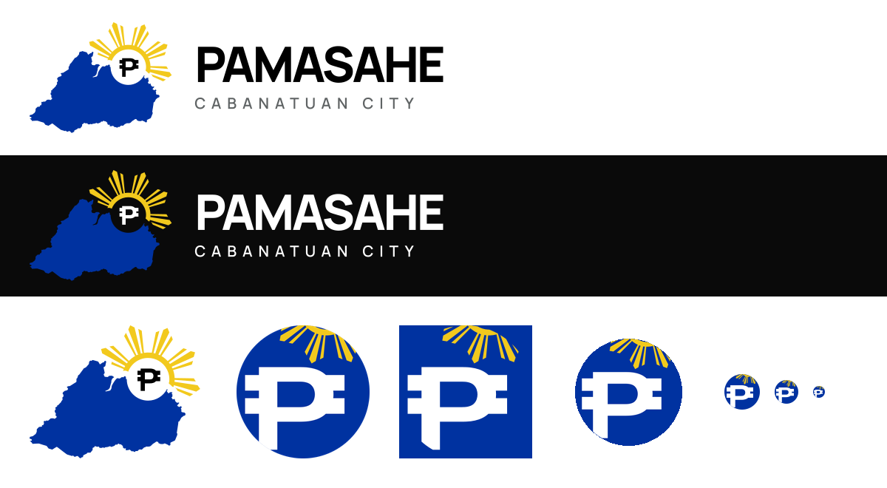

# Pamasahe logo

A sibling of the [BetterCabanatuan](https://bettercabanatuan.org) logo: the Cabanatuan city silhouette with the Philippine sun rising behind it and the peso inside the sun. Same palette as BetterCabanatuan: blue `#0032A0`, sun yellow `#F2C91D`; the wordmark is black `#000000` with a grey `#5F6364` "Cabanatuan City" line.

Top: the lockup on light and dark backgrounds. Bottom: the mark, the round icon, the iOS tile, the Android maskable icon (under the tightest circle mask) and the favicon at 48, 32 and 16 px.

| File | Use |
|---|---|
| `public/logo-lockup.svg` | Mark plus "Pamasahe · Cabanatuan City" wordmark, for light backgrounds. The designer's master file; the wordmark is already outlined. |
| `public/logo-lockup-dark.svg` | The same lockup with a white wordmark and peso, for dark backgrounds (the footer). |
| `public/logo.svg` | The lockup without the wordmark (navbar via `src/components/shared/logo-mark.tsx`). Light backgrounds only: the peso is black on a see-through disc. |
| `src/app/icon.svg` | Browser favicon: the round icon, a white peso on a blue disc with the sun rising at the top. |
| `src/app/favicon.ico` | 16, 32 and 48 px of the round icon, for browsers that ignore SVG favicons. |
| `src/app/apple-icon.png` | 180 px iOS home-screen icon: the round icon on a full-bleed blue tile, since iOS turns transparency black; iOS rounds the corners. |
| `public/icons/icon-192.png`, `icon-512.png` | Web app manifest icons: the round icon. |
| `public/icons/icon-maskable-512.png` | Android maskable icon: the round icon inside the 80% safe zone on full-bleed blue. |

The round icon is rebuilt as a vector from the lockup's own sun and peso paths (the peso stretched wider, as in the designer's icon), so it stays sharp at every size.
